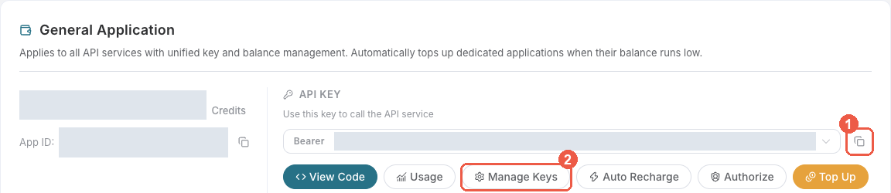

# Veo video for AstrBot

Generate one Veo video in an AstrBot conversation through your own Ace Data Cloud account. `veo_generate_video` submits one text or image video job, and `veo_get_task` retrieves the same task until its final video is ready.

This independent **Veo integration is provided by Ace Data Cloud**; it is not an official plugin from the Veo publisher or the AstrBot team. Use your own Ace API key.

[简体中文指南](readme/README_zh_Hans.md) · [Veo Videos API](https://platform.acedata.cloud/documents/veo-videos?utm_source=opensource&utm_medium=referral&utm_campaign=evergreen&utm_content=veoastrbot_readme_documents_veo_videos) · [Veo Tasks API](https://platform.acedata.cloud/documents/veo-tasks?utm_source=opensource&utm_medium=referral&utm_campaign=evergreen&utm_content=veoastrbot_readme_documents_veo_tasks) · [Current prices](https://platform.acedata.cloud/services/veo?utm_source=opensource&utm_medium=referral&utm_campaign=evergreen&utm_content=veoastrbot_readme_services_veo)

## 1. Find and install

Current upstream navigation is **Plugins → Plugins → Plugin Market / Installed**; older English versions may label the section Extensions. Search **Veo** and verify **Veo by Ace Data Cloud**, author **acedatacloud**, and the matching service icon.

**Publication status on 2026-10-19: not publicly listed in the official market.** The market search/install instructions above apply after publication. For the current preview, use the repository path below rather than waiting for a card that is not there.

Repository installation: **Plugins → Plugins → Installed → Install Plugin (+) → Install from URL**, with `https://github.com/AceDataCloud/VeoAstrBot`. Source is already available. Confirm it is enabled and loaded. A repository/file installation is a separate path from official market installation.

## Configure your key

New account? Register and sign in first. If the Applications page has no General application yet, choose **Initialize General Application**, then continue with the key steps below.

In [Ace Data Cloud Applications](https://platform.acedata.cloud/console/applications?utm_source=opensource&utm_medium=referral&utm_campaign=evergreen&utm_content=veoastrbot_readme_api_key), copy a generation API key from your General application or create a key that permits both `/veo/videos` and `/veo/tasks`. Check the current model and resolution price and your balance before submitting. Paste the key into the plugin's **Ace Data Cloud generation API key with Veo access** setting. Do not add `Bearer ` or use a `platform-...` management token. AstrBot masks the field in WebUI but stores the original value in its data directory, which should be protected.

Select a chat model that supports tool calling. Allow both Veo tools in the conversation's profile and persona.

### Token screenshots: copy or create a dedicated key

[Register or sign in to Ace](https://platform.acedata.cloud/console/applications?utm_source=opensource&utm_medium=referral&utm_campaign=evergreen&utm_content=veoastrbot_readme_signup), then open **Applications → General application** and initialize it if absent. Use **1** to copy the selected key, or **2 Manage Keys → Create** for a dedicated key. If Allowed APIs is enabled, include `/veo/tasks` and `/veo/videos`; check current entitlement, balance and prices before use.

Use a name such as `AstrBot Veo` and set expiry/limits as needed. The screenshot’s `Dify tutorial` is an older example, not a required label.

Images were reused and checked on **2026-10-19**; original capture dates are unknown. Credentials, App ID and balance are redacted. This is the shared Ace Applications UI, not proof of AstrBot installation or a live service call. [Image sources and limits](_assets/tutorial/sources.json).

### Where to paste it in AstrBot

Open **Plugins → Plugins → Installed**, select the gear (**Plugin Configuration**) on **Veo by Ace Data Cloud**, paste the key into **Ace Data Cloud generation API key with Veo access** (stored field `api_key`), and save. Paste the key only, with no `Bearer ` prefix; never put it in model-provider settings or a chat prompt. UI masking does not encrypt the data-directory config. These are exact text steps; no fabricated settings image is used.

## Generate once, then query

Ask the bot:

> Use `veo_generate_video` exactly once to create a short video of a yellow paper kite rising over a calm green meadow. Use `veo31-fast` with the default resolution. Show me the task ID.

The tool sends one asynchronous `POST /veo/videos` request and returns `status: submitted` with a task ID. Keep the ID and ask:

> Use `veo_get_task` with the exact task ID `<task_id>`. Tell me its status and final video URL. Do not generate another video.

If pending, query the same ID later. Only `status: succeeded`, `success: true`, and a final HTTPS video URL indicate completion. The plugin never retries a paid submission automatically.

This first version supports text-to-video with `veo3`, `veo3-fast`, `veo31`, or `veo31-fast`. To animate an image you own or may process, include its public HTTPS URL as `image_url`; `aspect_ratio` is `16:9` or `9:16` for this image-to-video mode. Omit `resolution` for the API default, or explicitly choose `1080p`, `4k`, or `gif` after checking the current price. Multi-image ingredients, 1080p upscaling, and other advanced actions are outside this first version.

## Verify and troubleshoot

In Ace Data Cloud usage, match a returned trace ID when available. A finished task may return public `cost` amounts in Credits; confirm the live usage row before treating an estimate as a charge. Task lookup reads an existing job and does not submit another generation.

| Symptom | Check |
| --- | --- |
| Plugin fails to load | AstrBot version, **Failed to Load Plugins**, and **Data & Logs → Logs**. |
| Tools are missing | Plugin enabled, both tools allowed in the active profile and persona, chat model supports tool calling. |
| HTTP 401/403 | Key type, both allowed API paths, and account access. |
| Network error after submission | Inspect request history before generating again; a timeout may already have created a paid task. |
| Pending task | Query the same task ID later. |
| Failed task | Use the task or trace ID to inspect request history. |

The key goes only to `https://api.acedata.cloud`; redirects are rejected. The plugin exposes final video URLs and public cost fields to the model, without raw internal data. It uses Python's standard library and needs no runtime package installation.

## Validation and brand asset

On official AstrBot `v4.28.2`, an isolated editable installation registered both tools. ChatUI submitted one `veo31-fast` text video and queried the same task ID twice; the first lookup was pending and the second returned success, with no second generation. The final MP4 responded HTTP 200, `video/mp4`, and decoded as H.264 video with AAC audio, 1280×720, 8 seconds. The exact generation trace matched one successful `/veo/videos` usage row with 0.648 Credits deducted; the task returned 0.72 Credits as its list amount. See the [sanitized evidence](tests/e2e-results.json). Image-to-video, other models, and optional resolutions were validated structurally but not generated. This is a local editable installation; official Cloud review, market installation, and a first call from a market installation remain open.

`logo.png` is a PNG encoding of the unmodified 900×900 [current Veo service icon](https://cdn.acedata.cloud/8nxyy9.jpg). Source JPEG SHA-256: `26bf44b131bf91b6e7b4ce1df82925346b7e850583d8f5fa8f449d4350fd5af8`; packaged PNG SHA-256: `b9a18c80092c522aa8e11f4918c13def1ba340831bda83f9c935f76e0d011fa2`.
